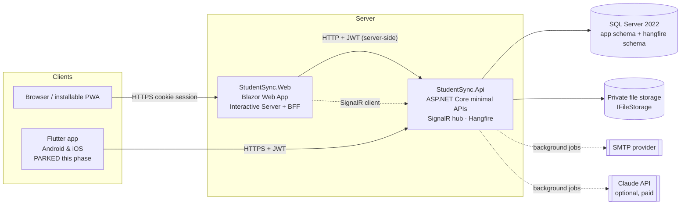
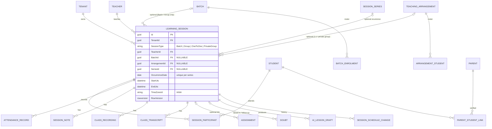
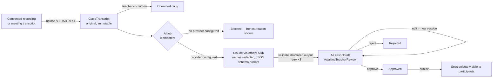

# Student Sync — Architecture

This document describes how Student Sync is built and why. It is the reference for engineers working on the codebase.
Product requirements live in `Student_Sync_Master_Prompt.md`; engineering rules in `CLAUDE.md`; visual rules in `DESIGN.md`.

## 1. System overview



* **One backend.** Web (and, when re-enabled, Flutter) use the same REST API (`/api/v1`). Business rules, authorization and tenancy are enforced only in the API.
* **Backend-for-frontend web.** The Blazor app runs interactively on the server. On sign-in the web server receives the API tokens and keeps them in a server-side session store; the browser only holds an HttpOnly, SameSite=Lax cookie containing an opaque session id. API tokens never reach the browser.
* **Mobile (parked).** The Flutter app in `mobile/student_sync` is out of scope for the current phase (owner decision 2026-11-04): it is not built, tested or kept in parity, and its CI job is commented out. When re-enabled it stores its tokens in the OS keychain/keystore and calls the API directly. This phase ships the web portals and the installable PWA only.
* **Real time.** The API exposes a SignalR hub (`/hubs/notifications`). Each connection joins only its own user group; the web server connects on behalf of the signed-in user to show live notification toasts and unread counts.
* **Background work** (reminders, doubt follow-up, digests, retention, AI jobs, notification delivery) runs in Hangfire with SQL Server storage. Tests use an inline job runner.

## 2. Solution layout (Clean Architecture, modular monolith)

| Project | Responsibility | Depends on |
|---|---|---|
| `StudentSync.Domain` | Entities, enums, invariants and state machines (session shape rules, recurrence, DST resolution, doubt transitions, grading, AI approval gate) | — |
| `StudentSync.Contracts` | Request/response DTOs shared by API and web | Domain (enums only) |
| `StudentSync.Application` | Use-case services per module, resource-level access policy, audit and notification services, background job logic, abstractions (`IAppDbContext`, `IFileStorage`, `ILanguageModel`, …) | Domain, Contracts, EF Core abstractions |
| `StudentSync.Infrastructure` | EF Core `AppDbContext`, model configuration and migrations, ASP.NET Core Identity, JWT issuing, file storage, SMTP, Claude adapter, Hangfire adapter, seeders | Application |
| `StudentSync.Api` | HTTP endpoints, authentication/authorization, error mapping, SignalR, Hangfire host, health checks, CLI commands (`migrate`, `seed-demo`, `reset-demo`) | Infrastructure |
| `StudentSync.Web` | Blazor UI, design system, BFF session store, API client | Contracts |
| `mobile/student_sync` | Flutter app — **parked**, not part of this phase | API (HTTP) |

Modules inside Application: Platform & Institution, People, Academics, Scheduling (sessions, attendance, availability, calendar export), Content (files, notes, materials, recordings, consent), Assignments, Assessments (question bank, exams), Doubts, Communication (messaging, announcements, notifications), AI (transcripts, drafts, review, student assistant), Reporting (dashboards, progress, reports), Jobs.

Controllers are thin minimal-API lambdas that call one service method. Services use EF Core directly through `IAppDbContext` (no generic repositories). Domain rules that must never be bypassed (e.g. "a one-to-one session has exactly one student and no batch", "AI drafts must be approved before publishing") live on the entities and are also enforced by database check constraints where expressible.

## 3. Teaching modes — sessions never require a batch



| Mode | `BatchId` | Participants | Enforced by |
|---|---|---|---|
| Batch class | required | copied from active batch enrolments at scheduling time | `LearningSession.ValidateShape` + `CK_Sessions_BatchRequired` |
| Group session (ad hoc) | optional | explicit selection | `ValidateShape` (≥1 student) |
| One-to-one | must be NULL | exactly one | `ValidateShape` + `CK_Sessions_NoBatchForPrivate` |
| Private group | must be NULL | explicit selection or arrangement roster | `ValidateShape` + `CK_Sessions_NoBatchForPrivate` |

Participation is always modelled with `SessionParticipants` (unique `(SessionId, StudentId)`); removals are status changes with a reason and a `SessionScheduleChanges` history row. Notes, materials, recordings, transcripts, AI drafts, assignments, exams and doubts reference the **session**, never a batch, so every workflow works when `BatchId` is NULL (covered by integration tests).

## 4. Scheduling and time zones

* Instants are stored as UTC `datetime2` (an EF value converter forces `DateTimeKind.Utc` on read). Each session also stores the IANA `TimeZoneId` it was scheduled in.
* Recurring schedules are expanded in **local calendar dates** (`RecurrencePattern`) and each occurrence is converted separately (`ZonedTime.ToUtc`), so a 19:00 Dubai lesson or a 17:00 London lesson keeps its wall-clock time across DST changes.
* Nonexistent local times (spring-forward gap) shift forward by the gap; ambiguous times (fall-back overlap) use the first occurrence. Both are reported back to the scheduler as warnings.
* Occurrences are materialised up-front (max 400 / 3 years), unique per `(SeriesId, OccurrenceDate)`. Institution holidays can be skipped.
* Conflict detection runs before every create/reschedule/participant add: teacher double-booking is blocking; student overlaps require explicit acknowledgement.
* Every user has a time zone; the UI renders times in the viewer's zone and shows the organiser's zone when different. ICS export is available per user.

## 5. Multi-tenancy, authentication and authorization

```mermaid
sequenceDiagram
    participant C as Client
    participant A as API
    participant DB as SQL Server
    C->>A: POST /auth/login (email, password, institution code?)
    A->>DB: find user by (TenantId, NormalizedEmail); check lockout + tenant status
    A-->>C: access JWT (15 min: sub, tid, role, tz) + rotating refresh token (30 days, hashed in DB)
    C->>A: GET /sessions (Bearer JWT)
    Note over A: CurrentUser ← claims only (never request body)<br/>TenantContext ← tid claim
    A->>DB: query with global filter TenantId = @tid<br/>+ AccessPolicy (teacher: own; student: participant; parent: verified child)
```

* **Tenant isolation.** Every tenant-owned entity implements `ITenantOwned`. EF global query filters restrict all queries to the caller's tenant; a platform context (super admin) matches no tenant rows. `SaveChanges` stamps `TenantId` on new rows and throws `TenantIsolationException` if a row for another tenant is added, modified or deleted. Related IDs from requests are always re-loaded through the filtered sets, so a foreign ID behaves as "not found".
* **Resource-level authorization.** `AccessPolicy` defines who may see which sessions, students, doubts, assignments and files. Records the caller cannot see return **404** (no existence leak); visible-but-not-editable returns 403.
* **Permissions.** Role → permission matrix in `RolePermissions` (fine-grained strings such as `sessions.manage_own`, `attendance.mark`). Endpoints declare coarse permissions (`RequirePermission`), services check the specific resource.
* **Super admin** manages institutions, plans, subscriptions and sees aggregate counts only. There is no route to institution learning content.
* **Accounts.** ASP.NET Core Identity (PBKDF2 hashing, lockout after 5 failures). Email uniqueness is per tenant; when one email exists in several institutions, sign-in asks for the institution code. New accounts get a random temporary password and must change it before any other API call (`PasswordChangeGate`).
* **Refresh tokens** are stored as SHA-256 hashes, rotated on each use; presenting a rotated token revokes the whole token family (theft detection). Suspending an institution or deactivating a user revokes their refresh tokens.

## 6. Data strategy

| Concern | Decision |
|---|---|
| Primary keys | `uniqueidentifier`, generated by EF Core's sequential GUID generator (SQL Server–friendly ordering). Teacher/Student/Parent profiles share the user's id (1:1). |
| Business keys | Tenant-scoped unique indexes: `(TenantId, NormalizedEmail)`, `(TenantId, StudentCode)`, `(TenantId, Code)` for courses/subjects/batches, `Tenants.Slug`. |
| Duplicate prevention | Unique join rows: enrolments, participants, attendance `(SessionId, StudentId)`, recipients, exam answers, `(ExamId, StudentId, AttemptNumber)`, `(SeriesId, OccurrenceDate)`, agenda `(SessionId, DoubtId)`, notifications `(UserId, DedupeKey)`, deliveries `(NotificationId, Channel)`, AI jobs `(TenantId, IdempotencyKey)`, idempotency records `(UserId, Key)`. |
| Concurrency | `rowversion` on every auditable entity; editable DTOs carry `RowVersion`; mismatches return 409. |
| Deletion | `Restrict` on every foreign key except pure child rows of one aggregate (question options, recipients, transcript segments, draft versions, plan features, Identity tables). People/batches/courses are archived via status, never deleted. Recordings are soft-deleted; retention job removes media bytes. |
| Audit | `AuditLogs` (append-only, no FKs) for sign-ins, schedule changes, participant changes, grading, consent, AI review actions, settings, platform operations. Audit columns (`CreatedAtUtc/By`, `UpdatedAtUtc/By`) are set from the authenticated user. |
| Money | `decimal(18,2)`. |
| Files | Bytes in `IFileStorage` (local disk in development; replace with S3/Azure Blob in production); metadata + SHA-256 in `Files`. Downloads need a 5–30 minute, user- and tenant-bound Data Protection token issued only after an access check on the owning record. Uploads are type- and size-checked and verified by magic number. |
| Profile photos | `AppUser.PhotoFileId` → a `Files` row with purpose `Avatar` (JPEG/PNG, ≤ 5 MB). Before storage a dependency-free stripper (`ImageMetadataStripper`) drops JPEG APP1/APP13/COM segments and PNG tEXt/zTXt/iTXt/eXIf/tIME chunks (GPS, camera details). Endpoints: `PUT`/`DELETE /me/photo` (any institution user, returns `CurrentUserDto`), `PUT`/`DELETE /teachers/{id}/photo` and `/students/{id}/photo` (admins, `users.manage`, audited as `person.photo.updated`/`person.photo.removed`; other institutions get 404). Responses carry `photoUrl` (`CurrentUserDto`, `TeacherDto`, `StudentDto`) and `teacherPhotoUrl` (`SessionListItemDto`, `SessionDetailDto`): `/api/v1/files/download?token=…&v=<fileId>` with a 12-hour viewer-bound token (`PhotoUrls`); `v` is only a client cache key. Visibility: staff photos to anyone signed in at the institution; a student's photo only to the student, admins and teachers who teach them (never other students or parents) — enforced in the DTO builders and in `FileService` access checks. Replacing/removing soft-deletes the old file. |
| Student learning path (subjects & syllabus) | Read-only `MySubjectsService` (tag "Learning"): `GET /my/subjects` → `MySubjectDto[]` (subjects with at least one visible class, ordered by the next scheduled/live class, then name) and `GET /my/subjects/{subjectId}` → `SubjectSyllabusDto` (all chapters by `SortOrder`, then an "Other classes" group, `chapterId: null`, for classes without a chapter of that subject). Everything is derived from `AccessPolicy.VisibleSessionsAsync` (student: own classes; teacher: classes they teach; admin: all); a subject with no visible class is a 404, other roles get 403. Sessions use `SchedulingService.Project` + `PhotoUrls`, videos come from `VideoService.ForSubjectsAsync` (same lock/`fileId` rule as `GET /videos`), recordings from `ContentService.SubjectRecordingsAsync` (`Available` only, library rule). Chapter status (`SyllabusChapterStatus`): `notScheduled` / `upcoming` / `inProgress` / `completed`, ignoring cancelled classes; class counts also exclude cancelled classes. A fixed number of queries per call (list: grouped aggregate; no per-chapter queries); a syllabus loads at most 1,000 classes. |
| Transactions | Single `SaveChanges` per command (atomic); explicit transactions where Identity and app rows are created together (people, institutions, demo seed). |
| Migrations | EF Core migrations in `Infrastructure/Persistence/Migrations`; reviewed before applying; applied by `dotnet run -- migrate` or `Database:MigrateOnStartup`. |

### Data dictionary (core tables)

| Table | Purpose | Key constraints |
|---|---|---|
| `Tenants` | Institution and its policies (recording/transcription/AI flags, retention, messaging rules) | `Slug` unique; retention 7–3650 days |
| `Plans`, `PlanFeatures`, `Subscriptions`, `SubscriptionEvents` | SaaS plans, limits, one subscription per tenant, history | `Plans.Code` unique; `Subscriptions.TenantId` unique |
| `AspNetUsers` | Accounts (`TenantId` null for platform admins), role, time zone, language | `(TenantId, NormalizedEmail)` unique |
| `Teachers`, `Students`, `Parents` | Role profiles (PK = user id) | `(TenantId, StudentCode)` unique |
| `ParentLinks` | Verified guardian ↔ child | `(ParentId, StudentId)` unique |
| `AcademicYears`, `Terms`, `GradeLevels`, `Courses`, `Subjects`, `Chapters`, `Topics` | Academic structure | tenant-scoped unique names/codes |
| `TeacherSubjects`, `CourseEnrolments` | Authorisation to teach; course membership | unique pairs |
| `Batches`, `BatchEnrolments` | Optional cohorts | capacity > 0 |
| `Arrangements`, `ArrangementStudents` | One-to-one / private group relationships | one student for one-to-one (domain) |
| `SessionSeries`, `Sessions`, `SessionParticipants`, `SessionChanges`, `AgendaItems` | Scheduling | check constraints in §3 |
| `Attendance` | One row per session/student | `(SessionId, StudentId)` unique |
| `Files`, `Notes`, `Materials`, `Recordings`, `RecordingProgress`, `Consents`, `Transcripts`, `TranscriptSegments` | Content | materials: file **or** link |
| `Assignments`, `AssignmentRecipients`, `AssignmentAttachments`, `Submissions`, `SubmissionFiles` | Homework | max marks > 0; one submission per student |
| `Questions`, `QuestionOptions`, `Exams`, `ExamQuestions`, `ExamRecipients`, `ExamAttempts`, `ExamAnswers` | Assessments | exam window and attempt checks |
| `Doubts`, `DoubtMessages`, `DoubtAttachments`, `DoubtStatusChanges` | Doubt Centre | state machine in domain |
| `Conversations`, `ConversationParticipants`, `Messages`, `Announcements` | Communication | direct conversation unique per pair |
| `Notifications`, `NotificationDeliveries`, `NotificationPreferences`, `Devices` | Notifications | dedupe keys |
| `AiJobs`, `AiDrafts`, `AiDraftVersions`, `AiUsage` | AI Class Assistant | idempotency key; version history |
| `AuditLogs`, `IdempotencyRecords`, `Integrations`, `FeatureFlags`, `RefreshTokens` | Platform | |

## 7. AI Class Assistant



* Gates: institution flags (recording, transcription, AI), per-participant consent records (student or verified guardian; staff can record paper consent), plan's monthly AI job quota.
* The transcript sent to the model has participants' names redacted. The prompt forbids invented formulas/homework/deadlines; homework items must quote transcript evidence; practice questions, flashcards and agenda are labelled "AI suggestion" everywhere.
* `LessonDraftContent.Validate()` rejects malformed output before it is stored. A draft cannot become `Published` without `Approved` (domain rule + test); edits after approval require re-approval and are versioned.
* The student assistant retrieves only **published, participant-visible notes** from sessions the student attends and answers from those; without a provider it returns the matching approved excerpts instead.
* Provider: `ClaudeLanguageModel` (official Anthropic .NET SDK, model `claude-opus-5-5` by default, server-side refusal fallback enabled). It is inactive unless `Ai:Anthropic:ApiKey` is set; usage tokens and an estimated cost are stored in `AiUsage`. Transcription: interface only (no provider configured).

## 8. Notifications

`NotificationService` writes in-app notifications inside the business transaction, deduplicated by `(UserId, DedupeKey)`. After commit, `NotificationDispatcher` pushes them over SignalR and enqueues `NotificationDeliveryJob`, which sends email (MailKit/SMTP) or push (adapter; not configured), respecting per-user channel preferences, muted types and quiet hours in the user's time zone. Delivery rows are `Accepted` only when the provider accepts the message; otherwise `Skipped` with the reason or `Failed` after retries.

Recurring jobs: session reminders (every 5 min, 60 min ahead), doubt follow-up (hourly), assignment due reminders (hourly, 24 h ahead), exam auto-finalisation (every 5 min), recording retention (daily), weekly parent digest (Fridays). Each runs per tenant in its own DI and tenant scope; one tenant's failure doesn't stop others.

## 9. Error and API conventions

* JSON, camelCase, enums as strings, UTC ISO-8601 times. Lists are paged (`page`, `pageSize` ≤ 100) or bounded.
* Errors are RFC 7807 problem details with a stable `code`: `validation_failed` (400, with `errors`), `invalid_credentials`/`institution_code_required` (401/400), `forbidden` (403), `password_change_required` (403), `not_found` (404), `teacher_conflict`/`student_conflict`/`concurrency_conflict`/`duplicate` (409, conflicts include `details`), domain rule codes (422, e.g. `batch_required`, `consent_required`, `approval_required`).
* `Idempotency-Key` header is honoured on session creation, submissions, doubts and messages.
* OpenAPI document at `/openapi/v1.json`, Swagger UI at `/swagger`.
* Rate limits: sign-in endpoints per IP, AI assistant per user.

## 10. Key decisions

| Decision | Reason |
|---|---|
| Blazor **Interactive Server** with a BFF session store (not WebAssembly) | Keeps API tokens off the browser, faster to load, simpler secure cookie model. Trade-off: no offline interactivity; the PWA offers an offline page with explicitly saved notes only. |
| Minimal APIs instead of MVC controllers | Thin endpoints; all logic in services. |
| EF Core directly in application services | Avoids repository boilerplate; tenant filters and access policy are central. |
| Explicit validation in services + domain (no FluentValidation) | One place per rule, returned as field errors; avoids a second rule set. |
| Up-front materialisation of recurring sessions | Deterministic, testable, simple conflict detection; bounded to 400 occurrences. |
| Local file storage adapter | Works for development and single-node; production should implement `IFileStorage` over S3/Azure Blob (signed URLs are already token-based). |
| Hangfire on SQL Server | No extra infrastructure; dashboard only from localhost in Development. |
| Anthropic official SDK, `claude-opus-5-5` | Per project guidance; configurable model/pricing; disabled until a key is supplied (paid service requires approval). |
| Curriculum as data: `Subject.Kind` (Core / LanguageOption / Additional) + `ChoiceGroup`, and `StudentSubject` rows (2026-11-03) | CBSE language rules are changing (R1/R2/R3 from 2026-27), so no language rule is coded: a standard's languages are configurable choice groups. A student's subjects = active Core subjects of their active courses ∪ their `StudentSubject` rows (language choices and extras from any course) — one rule, `StudentCurriculum.SubjectsOf`, used by `/my/subjects`, `/academics/subjects` (students) and the admin API. Counts still come only from visible classes. |
| Admin-only accounts and the student learning profile (2026-11-04, CLAUDE.md addendum B/C) | Self-registration is gone (no `/auth/register`, no approval queue; `PersonStatus` = Active / Inactive / Archived / Suspended); credentials are issued only by admins (`CreateStudentAsync`, `ResetPasswordAsync` → one-time temporary password, forced change). `Curriculum` (syllabus catalogue: NCERT, Kerala State, …) and `AcademicYear` are optional references on `Student`. Weak subjects are `StudentLearningNeed` rows (subject, optional chapter, `Source` Student / Parent / Admin / Teacher / Diagnostic, Open → Resolved with a review note; one open row per student/subject/chapter via a filtered unique index) and goals/observations are `StudentNote` rows (Goal is student-visible, Observation staff-only). `LearningProfileService` enforces scope: admins any student, teachers only students they teach (`AccessPolicy.VisibleStudentIdsAsync`), students only themselves through `/my/*` and only as `Source.Student`. Sign-in bookkeeping is a direct column update so concurrent sign-ins cannot conflict on the Identity concurrency stamp. |
| Diagnostic assessments reuse the exam engine (2026-11-04, addendum C) | No second engine: `Exam.Purpose = Diagnostic` plus optional `GradeLevelId`/`CurriculumId`; questions carry `ChapterId` and an optional private `ImageFileId`. Paper (OMR-style) sheets are entered by staff as an `ExamAttempt` with `EntryMode = PaperEntered` and marked by the same `QuestionGrader`. `DiagnosticBreakdown` (pure, unit-tested) aggregates marks per subject/chapter; rows below 50 % need attention, unmarked rows stay pending and are never flagged. Recording a row creates a `StudentLearningNeed` with `Source = Diagnostic` — the only way that source is set. A teacher who runs a published exam for a student counts as teaching them. |
